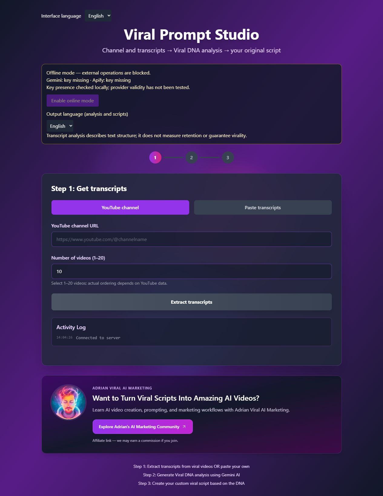
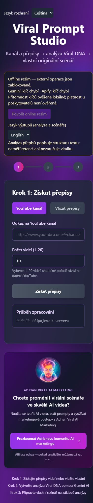

# Viral Prompt Studio

### From a YouTube channel to original scripts of your own.

**Understand how successful videos are structured — then apply the storytelling principles to your own ideas.**

Paste the URL of an entire YouTube channel, choose how many videos to examine, and collect their transcripts. Gemini turns those texts into a **Viral DNA** profile: opening hooks, narrative transitions, sentence rhythm, and recurring storytelling patterns. Use that profile as reference material for an AI agent, or generate an original script about your own topic inside the application.

The goal is not to copy someone else's videos. It is to understand their structure and create **new stories in your own words**.

[Česká dokumentace](README.md) · [Windows installation](#windows-installation) · [Viral DNA example](docs/VIRAL-DNA-EXAMPLE.md) · [Release review — Czech](docs/RELEASE-REVIEW.md) · [MIT and attribution](NOTICE.md)

**Local Windows application · English / Czech interface · Bring your own Gemini and Apify keys · Offline on every backend start**



*An actual screenshot of a clean installation. Offline mode and missing keys are intentional: no private credentials or paid-run results are used in this documentation.*

## One channel. A clearer structure. Your own creative work.

Instead of collecting disconnected videos and generic writing advice, bring a set of transcripts into one workflow. Examine **how a creator introduces a problem, builds anticipation, connects ideas, and delivers a payoff**.

- **Start with a channel.** Enter a channel URL and a count of 1–20 videos. yt-dlp requests a popular-video selection; Apify retrieves the transcripts.
- **Bring your own material.** Paste transcripts you already have to skip extraction.
- **Separate research from writing.** Review the transcripts, create Viral DNA, then independently request a script for your topic.
- **Keep the results.** Copy or download transcripts, analysis, and scripts as TXT files.
- **Choose two languages independently.** Interface language: Čeština / English. Analysis and script language: English / Čeština, with English as the default output.

The selection aims to retrieve the channel's most popular videos. Actual ordering depends on YouTube, yt-dlp, and transcript availability. The application does not independently certify the “most successful” videos or measure viewer retention.

## The workflow

```text
YouTube channel URL → video count → transcripts → AI analysis → Viral DNA
                                                                  ├─→ your topic → original script
                                                                  └─→ reference for an AI agent
                                                                        └─→ installable SKILL.md [PLANNED]
```

| Stage | Your action | Result |
|---|---|---|
| 1. Select | Enter a channel URL and count, or paste transcripts | A collection of source texts |
| 2. Review | Inspect the available transcripts | Copyable and downloadable research material |
| 3. Analyze | Request Gemini analysis | Viral DNA: hooks, transitions, text rhythm, and a reusable structure |
| 4. Create | Provide a new topic and output language | An original script inspired by general structural principles |
| 5. Reuse with an agent | Give the exported DNA to your agent as context | A manual reusable reference; automatic skill export is not available yet |

### What is actually exported today?

| Output | Current status |
|---|---|
| Transcripts: `subtitles.txt` | Available |
| Analysis: `viral_dna_analysis.txt` | Available after Gemini analysis |
| Script: `viral_script.txt` | Available after a separate generation request |
| Ready-to-install `SKILL.md` | **Planned extension — not implemented** |

You can already use Viral DNA as reference material when manually preparing a scriptwriting skill. The application does not create skill metadata, a skill folder structure, or an installer for Codex, Claude Code, or another agent. A TXT export is not an installable skill.

## A preview of Viral DNA

The following is a **manually written format illustration**, not a real channel analysis or measured data:

> **Hook:** a question or contradiction → a specific promise → a constraint that opens another question.  
> **Story arc:** problem → first attempt → complication → explanation → practical conclusion.  
> **Text rhythm:** a short orienting sentence, development of one idea, then a concise recap.  
> **Reusable structure:** `[audience question] → [promise] → [example] → [complication] → [resolution]`.  
> **Evidence limit:** transcripts alone do not establish actual cuts, visual pacing, or audience retention.

[Read the bilingual example](docs/VIRAL-DNA-EXAMPLE.md) for a practical distinction between textual observations, hypotheses, and guidance for original writing. It does not claim findings about a real creator.

## Actual application screenshots

[English desktop](docs/images/studio-en.jpg) · [Czech desktop](docs/images/studio-cs.jpg)

<details>
<summary>Mobile interface and affiliate card</summary>



</details>

These are screenshots of the working application, not design mockups. They show a clean installation with no API keys.

## Windows installation

**Requirements:** Windows, **Python 3.11+**, **Node.js 22.12+** with npm, and internet access for dependency downloads. Verified on Windows 10 x64 with Python 3.14 and Node.js 24. Other minimum-version combinations still need testing.

1. Install [Python](https://www.python.org/downloads/windows/) and [Node.js](https://nodejs.org/en/download), making them available on PATH.
2. Extract the source ZIP into its own writable folder. Administrator privileges are not required.
3. Open PowerShell in that folder:

```powershell
.\Install-Windows.ps1
.\Start-Viral-Prompt-Studio.ps1
```

The installer creates an isolated `.venv`, installs pinned Python dependencies, runs `npm ci --ignore-scripts`, builds React, and runs offline tests. It does not modify your global Python/Node environment. It creates `.env` from the empty example only when no configuration exists, and never overwrites an existing `.env`.

The launcher checks the backend and built page before opening your browser. **React and Flask share one local port.** It prefers port 3100 and selects a free alternative if needed, printing the actual URL. Starting it again from the same folder reuses the healthy instance; it does not terminate another application's processes.

```powershell
.\Start-Viral-Prompt-Studio.ps1 -Port 3200
.\Start-Viral-Prompt-Studio.ps1 -Port 0 -NoBrowser
```

If execution policy or endpoint protection blocks a script, review the source and local rules first. A trusted downloaded file can be unblocked through its Properties or `Unblock-File`. You do not need to disable antivirus or change global policies.

## Your own Gemini and Apify keys

Fill in your local `.env`:

```dotenv
GEMINI_API_KEY=
APIFY_API_KEY=
```

- **Gemini:** create a key in [Google AI Studio](https://aistudio.google.com/apikey). Follow the [official guide](https://aistudio.google.com/docs/api-key) to check permissions, model access, quotas, and billing.
- **Apify:** create a dedicated token in [Apify Console → API & Integrations](https://console.apify.com/settings/integrations). The [official guide](https://docs.apify.com/integrations/api) explains permissions and expiration.

**Never publish `.env`, credentials, or screenshots of their values.** The repository includes only `.env.example` with empty keys, and `.gitignore` excludes the real configuration.

The backend reads the explicit `.env` next to this README, regardless of the launch directory. Restart the backend after edits. Process environment variables take precedence; advanced provider-specific configuration files can be referenced with `VPS_GEMINI_ENV_FILE` and `VPS_APIFY_ENV_FILE`.

### Offline mode and costs

Every backend start begins **offline**. Both keys must be present before the online switch becomes available; presence does not prove that the provider accepts them. Switching mode alone makes no external request. Extraction and generation each require a separate confirmation in the interface.

YouTube/Apify extraction and Gemini analysis or generation may incur charges. The application **does not have a budget ledger or a guaranteed spending cap**. Check pricing and configure limits with your providers. Mode changes are blocked during extraction; an already submitted provider request must not be assumed cancelled.

The default model `gemini-3-flash-preview` and Apify Actor `faVsWy9VTSNVIhWpR` are configurable. Their current availability, prices, and live behavior were not verified through paid requests while preparing this release. Select values available to your account before online use.

## Turn your scripts into AI videos


### Want to Turn Viral Scripts Into Amazing AI Videos?

Learn AI video creation, prompting, and marketing workflows with Adrian Viral AI Marketing.

[Explore Adrian's AI Marketing Community](https://www.skool.com/adrian/about?ref=297517c89ef84acd9c347c22c501d262)

*Affiliate link — we may earn a commission if you join.*

Joining the community is not required to install or use the application. The same clearly disclosed card sits below the generator, with a locally served avatar.

## Operation, privacy, and evidence limits

- The application listens only on `127.0.0.1`. Do not expose it to the internet; it is not a multi-user hosted service with accounts.
- Metadata comes from YouTube, transcripts from Apify, and analysis text is sent to Gemini. **Online processing does not remain entirely on your computer.**
- Analysis covers text, not video frames or an observed editing timeline. “Pacing” means an inference about textual rhythm, not measured editing speed or audience retention.
- Transcript availability and video ordering can change. Videos without usable transcripts may be skipped.
- Respect source rights and provider terms. Learn from general structure without copying distinctive lines or impersonating a creator.
- Download results before restarting: working UI state is not durable. Local logs and files live in `.runtime/` and do not belong in the public archive.
- To stop the application, identify its Python process in `.runtime/server.json`; do not terminate unrelated Python programs. After changing keys, stop and restart the server and refresh the page.

## Tests and contributions

```powershell
.\.venv\Scripts\python.exe tools/run_offline_tests.py
python tools/release_check.py
```

The offline runner does not read real keys, mocks providers, and blocks test network connections. The release checker uses an explicit file manifest; it does not replace review of staged changes and Git history. The [release review](docs/RELEASE-REVIEW.md) records the test scope and limitations.

For frontend development, set matching `VPS_PORT` values for the backend/proxy and `VPS_DEV_PORT` for both the allowed origin and Vite, then run `npm run dev` inside `frontend/`. Normal users do not need the Vite development server.

When reporting a problem, include your OS, Python, and Node versions and a description. Do not include credentials, `.env`, or unreviewed logs.

## Roadmap: an AI agent skill

The intended extension is **Viral DNA → validated `SKILL.md` → a reusable scriptwriting skill for AI agents**. That export needs metadata, originality instructions, reference material, and validation for the target agent. Skill export and installation are not implemented in this version. No release date is promised.

## License and attribution

**MIT** — see [LICENSE](LICENSE) and [NOTICE.md](NOTICE.md). Based on [viral-content-cloner-agent](https://github.com/yashaiguy-dev/viral-content-cloner-agent) by **yashaiguy-dev**. Viral Prompt Studio is a derivative project, not an official release by the upstream author.

The upstream README declares MIT, but its inspected history contains no standalone LICENSE file. This distribution includes the standard MIT text with attribution; it is not presented as a verbatim copy of a nonexistent upstream file. NOTICE.md preserves the provenance and the recommendation to confirm the exact copyright notice.
