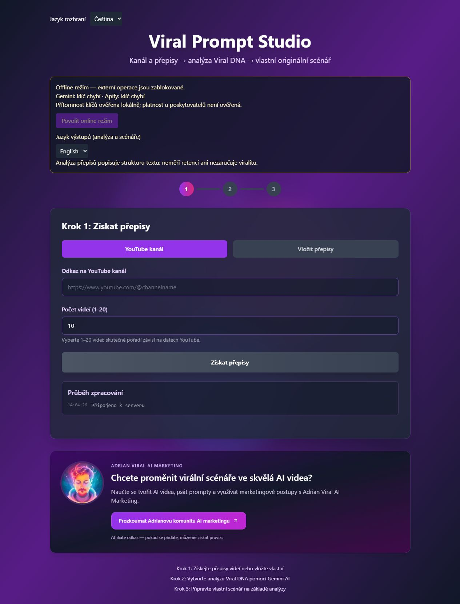

# Viral Prompt Studio

### Od YouTube kanálu k vlastním originálním scénářům.

**Zjistěte, jak jsou vystavěná úspěšná videa — a využijte jejich vyprávěcí principy pro vlastní nápady.**

Vložte URL celého YouTube kanálu, zvolte počet videí a získejte jejich přepisy. Gemini z nich připraví profil **Viral DNA**: strukturu úvodních hooků, návaznosti, rytmus vět a opakující se storytellingové postupy. Výsledek můžete použít jako podklad pro další práci s AI agentem nebo rovnou vytvořit scénář na své vlastní téma.

Cílem není kopírovat cizí videa. Cílem je porozumět jejich stavbě a psát **nové příběhy, vlastními slovy**.

[English documentation](README.en.md) · [Instalace na Windows](#instalace-na-windows) · [Ukázka Viral DNA](docs/VIRAL-DNA-EXAMPLE.md) · [Kontrola vydání](docs/RELEASE-REVIEW.md) · [MIT a původ](NOTICE.md)

**Lokální aplikace pro Windows · Čeština / English · Vlastní Gemini a Apify klíče · Offline po každém startu**



*Skutečný screenshot čisté instalace. Offline režim a chybějící klíče jsou záměrné: dokumentace neobsahuje přístupy ani výsledky placeného běhu.*

## Jeden kanál. Přehledná struktura. Vlastní tvorba.

Při hledání inspirace je snadné skončit u náhodných videí a obecných rad. Viral Prompt Studio soustředí vybraný soubor přepisů do jednoho pracovního postupu, abyste mohli porovnat, **jak autor otevírá téma, rozvíjí napětí a dovádí příběh k pointě**.

- **Začněte kanálem, ne ručním přepisováním.** Zadejte URL a počet 1–20 videí. Aplikace vyžádá populární výběr přes yt-dlp a přepisy přes Apify.
- **Pracujte i s vlastními podklady.** Již získané přepisy můžete vložit přímo, bez další extrakce.
- **Oddělte analýzu od psaní.** Nejprve zkontrolujete přepisy, pak vytvoříte Viral DNA. Scénář vzniká až samostatným krokem pro vaše téma.
- **Výsledky si ponechte.** Přepisy, analýzu i scénář lze kopírovat nebo stáhnout jako TXT.
- **Zvolte jazyk pro práci i pro publikum.** Jazyk rozhraní Čeština / English je nezávislý na jazyku výstupů English / Čeština. Výchozí výstup je English.

Výběr se snaží získat nejpopulárnější videa kanálu. Skutečné pořadí závisí na YouTube, yt-dlp a dostupnosti přepisů; aplikace neprovádí nezávislé ověření „nejúspěšnějších“ videí ani měření retence.

## Jak postup funguje

```text
URL YouTube kanálu → počet videí → přepisy → AI analýza → Viral DNA
                                                            ├─→ vlastní téma → originální scénář
                                                            └─→ podklad pro AI agenta
                                                                  └─→ instalovatelný SKILL.md [PLÁNOVÁNO]
```

| Krok | Co uděláte | Co dostanete |
|---|---|---|
| 1. Výběr | Vložíte URL kanálu a počet videí, případně vlastní přepisy | Soubor textových podkladů |
| 2. Kontrola | Projdete získané přepisy | Možnost podklady kopírovat nebo stáhnout |
| 3. Analýza | Spustíte Gemini analýzu | Profil Viral DNA: hooky, návaznosti, rytmus a šablona |
| 4. Vlastní tvorba | Zadáte nové téma a jazyk výstupu | Originální scénář inspirovaný obecnými strukturálními principy |
| 5. AI agent | Předáte exportované DNA svému agentovi jako kontext | Ručně opakovaně použitelný podklad; automatický skill export zatím není dostupný |

### Co aplikace skutečně exportuje

| Výstup | Současný stav |
|---|---|
| Přepisy `subtitles.txt` | Dostupné |
| Analýza `viral_dna_analysis.txt` | Dostupná po analýze Gemini |
| Scénář `viral_script.txt` | Dostupný po samostatném generování |
| Hotový instalovatelný `SKILL.md` | **Plánované rozšíření — není implementováno** |

Viral DNA již dnes může posloužit jako znalostní podklad při ruční přípravě scénáristického skillu. Aplikace ale nevytváří jeho metadata, složkovou strukturu ani instalátor pro Codex, Claude Code nebo jiné agenty. TXT export není instalovatelný skill.

## Jak vypadá Viral DNA

Níže je **ručně vytvořená ilustrace formátu**, nikoli výsledek skutečné analýzy kanálu nebo naměřená data:

> **Hook:** otázka nebo rozpor → konkrétní příslib → omezení, které vyvolá další otázku.  
> **Vyprávěcí oblouk:** problém → první pokus → komplikace → vysvětlení → praktický závěr.  
> **Rytmus textu:** krátká orientační věta, rozvedení jedné myšlenky, stručné shrnutí.  
> **Znovupoužitelná struktura:** `[otázka publika] → [příslib] → [příklad] → [komplikace] → [řešení]`.  
> **Hranice závěru:** z přepisu samotného nelze určit skutečné střihy, obrazové tempo ani diváckou retenci.

[Podrobnější ukázka v češtině a angličtině](docs/VIRAL-DNA-EXAMPLE.md) ukazuje, jak oddělovat textová pozorování, hypotézy a doporučení pro vlastní tvorbu. Ukázka nic nepředstírá jako zjištění o konkrétním autorovi.

## Skutečné rozhraní

[Anglický desktopový screenshot](docs/images/studio-en.jpg) · [Český desktopový screenshot](docs/images/studio-cs.jpg)

<details>
<summary>Mobilní rozhraní a affiliate karta</summary>


</details>

Screenshoty pocházejí ze skutečné aplikace, nikoli z grafického návrhu. Zachycují bezpečnou čistou instalaci bez API klíčů.

## Instalace na Windows

**Potřebujete:** Windows, Python **3.11+**, Node.js **22.12+** s npm a internet pro stažení závislostí. Ověřeno na Windows 10 x64 s Pythonem 3.14 a Node.js 24; ostatní kombinace minimálních verzí vyžadují další ověření.

1. Nainstalujte [Python](https://www.python.org/downloads/windows/) a [Node.js](https://nodejs.org/en/download). Zpřístupněte je v PATH.
2. Rozbalte zdrojový ZIP do samostatné zapisovatelné složky. Nepotřebujete administrátorská práva.
3. V této složce otevřete PowerShell:

```powershell
.\Install-Windows.ps1
.\Start-Viral-Prompt-Studio.ps1
```

Instalátor vytvoří izolované `.venv`, nainstaluje zamčené Python závislosti, provede `npm ci --ignore-scripts`, sestaví React a spustí offline testy. Nemění globální Python/Node prostředí. Pokud chybí `.env`, vytvoří jej z prázdného vzoru; existující konfiguraci nepřepisuje.

Spouštěč ověří backend i stránku a otevře prohlížeč. **React i Flask běží na jednom lokálním portu.** Preferovaný port je 3100; při obsazení se vybere volný port a vypíše se skutečná adresa. Opakované spuštění ze stejné složky použije běžící instanci, nezabíjí cizí procesy.

```powershell
.\Start-Viral-Prompt-Studio.ps1 -Port 3200
.\Start-Viral-Prompt-Studio.ps1 -Port 0 -NoBrowser
```

Pokud execution policy nebo ochrana systému skript blokuje, nejprve zkontrolujte zdroj a místní pravidla. Důvěryhodný stažený soubor lze odblokovat ve Vlastnostech nebo pomocí `Unblock-File`. Návod nevyžaduje vypnutí antiviru ani globální změnu politik.

## Vlastní Gemini a Apify klíče

Do svého lokálního `.env` doplňte:

```dotenv
GEMINI_API_KEY=
APIFY_API_KEY=
```

- **Gemini:** vytvořte klíč v [Google AI Studio](https://aistudio.google.com/apikey). Podle [oficiálního návodu](https://aistudio.google.com/docs/api-key) ověřte oprávnění, model, kvóty a případné účtování.
- **Apify:** v [Apify Console → API & Integrations](https://console.apify.com/settings/integrations) vytvořte vlastní token pro tuto aplikaci. [Oficiální návod](https://docs.apify.com/integrations/api) popisuje oprávnění a expiraci.

**Nikdy nezveřejňujte `.env`, klíče ani screenshoty jejich hodnot.** V repozitáři je pouze `.env.example` s prázdnými klíči. Skutečný `.env` je v `.gitignore`.

Backend používá konkrétní `.env` vedle README, nezávisle na pracovním adresáři. Změny vyžadují restart backendu. Proměnné procesu mají přednost; pokročilé oddělené konfigurace podporují `VPS_GEMINI_ENV_FILE` a `VPS_APIFY_ENV_FILE`.

### Offline režim a náklady

Každý start backendu začíná **offline**. Přítomnost obou klíčů zpřístupní přepínač online režimu; neprokazuje však jejich platnost u poskytovatelů. Samotné přepnutí žádné API nevolá. Extrakce i generování vyžadují samostatné potvrzení v rozhraní.

YouTube/Apify extrakce a Gemini analýza či generování mohou být zpoplatněné. Aplikace **nemá rozpočtový ledger ani zaručený finanční limit** — limity a ceny ověřte u poskytovatelů. Změna režimu během extrakce je zablokovaná; už odeslanou operaci nelze považovat za zrušenou.

Model `gemini-3-flash-preview` a Apify Actor `faVsWy9VTSNVIhWpR` jsou konfigurovatelné. Jejich dnešní dostupnost, cena a živé chování nejsou při přípravě tohoto vydání ověřené placeným voláním. Před online použitím zvolte hodnoty dostupné pro svůj účet.

## Od scénáře k AI videu


### Adrian Viral AI Marketing

Chcete proměnit vlastní scénáře v AI videa? Komunita Adrian Viral AI Marketing se zaměřuje na tvorbu AI videí, prompting a marketingové postupy.

[Prozkoumat Adrianovu komunitu AI marketingu](https://www.skool.com/adrian/about?ref=297517c89ef84acd9c347c22c501d262)

*Affiliate odkaz — pokud se přidáte, můžeme získat provizi.*

Komunita není nutná pro instalaci ani používání aplikace. Stejná transparentně označená karta je v rozhraní umístěná pod generátorem; obrázek se načítá lokálně.

## Provoz, soukromí a hranice analýzy

- Aplikace poslouchá pouze na `127.0.0.1`. Nevystavujte ji do internetu; nejde o víceuživatelskou službu s účty.
- Metadata pocházejí z YouTube, přepisy z Apify a texty k analýze jsou odesílány Gemini. **Online zpracování tedy neprobíhá celé lokálně.**
- Analyzuje se text, nikoli obraz a skutečná časová osa střihů. „Tempo“ znamená odhad rytmu textu, ne změřenou rychlost střihu nebo retenci.
- Dostupnost titulků a pořadí videí se mohou měnit. Videa bez přepisů mohou být přeskočena.
- Respektujte práva k podkladům a podmínky služeb. Struktura může být inspirací, cizí věty nebo identita autora nejsou šablonou ke kopírování.
- Výsledky si stáhněte před restartem; pracovní stav UI není trvale uložený. Lokální logy a soubory jsou v `.runtime/` a nepatří do veřejného balíčku.
- Pro ukončení použijte konkrétní Python proces uvedený v `.runtime/server.json`; neukončujte ostatní Python aplikace. Po úpravě klíčů server ukončete, znovu spusťte a obnovte stránku.

## Testy a příspěvky

```powershell
.\.venv\Scripts\python.exe tools/run_offline_tests.py
python tools/release_check.py
```

Offline runner nečte skutečné klíče, mockuje poskytovatele a blokuje síťová spojení testů. Kontrola vydání prověřuje explicitní seznam distribuovaných souborů; nenahrazuje kontrolu staged diff a historie. [Podrobný report](docs/RELEASE-REVIEW.md) uvádí rozsah testování a známá omezení.

Pro frontendový vývoj lze použít Vite: nastavte stejné `VPS_PORT` pro backend/proxy a `VPS_DEV_PORT` pro povolený origin i Vite, pak ve `frontend/` spusťte `npm run dev`. Běžný uživatel Vite server nepotřebuje.

Při hlášení chyby uveďte verze systému, Pythonu a Node.js a popis problému; neposílejte klíče, `.env` ani nekontrolované logy.

## Plánované rozšíření: AI agent skill

Budoucí směr je **Viral DNA → validovaný `SKILL.md` → opakovaně použitelný scénáristický skill pro AI agenty**. Export musí doplnit metadata, instrukce pro zachování originality, zdrojové podklady a validaci pro cílového agenta. V aktuální verzi tento export ani instalace skillu nejsou implementované. Není stanoven termín vydání.

## Licence a původ

**MIT** — viz [LICENSE](LICENSE) a [NOTICE.md](NOTICE.md). Projekt vychází z [viral-content-cloner-agent](https://github.com/yashaiguy-dev/viral-content-cloner-agent) od **yashaiguy-dev**. Viral Prompt Studio je odvozená verze, nikoli oficiální vydání původního autora.

Upstream deklaruje MIT v README, ale jeho kontrolovaná historie neobsahuje samostatný LICENSE. Zde je standardní text MIT s atribucí; nejde o doslovnou kopii neexistujícího upstream souboru. Přesný původ a doporučení k ověření copyright notice jsou zachované v NOTICE.md.
